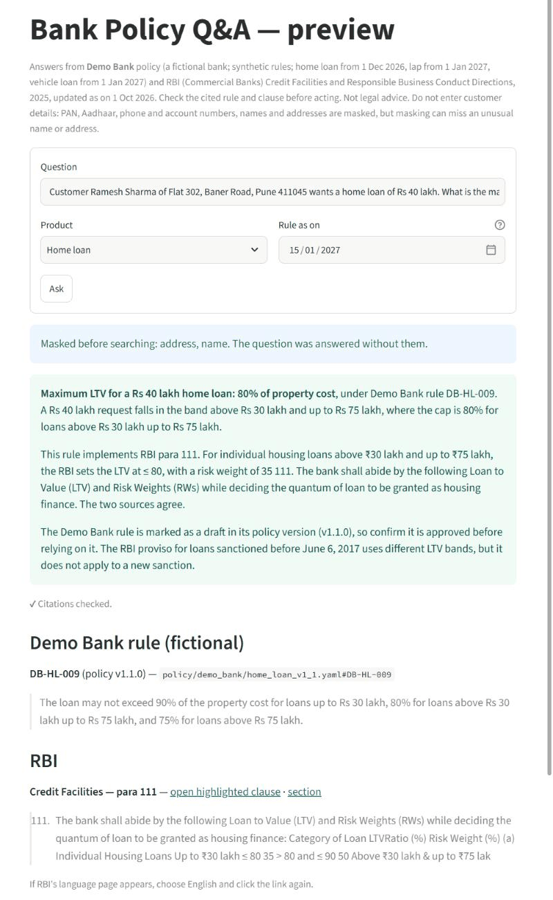
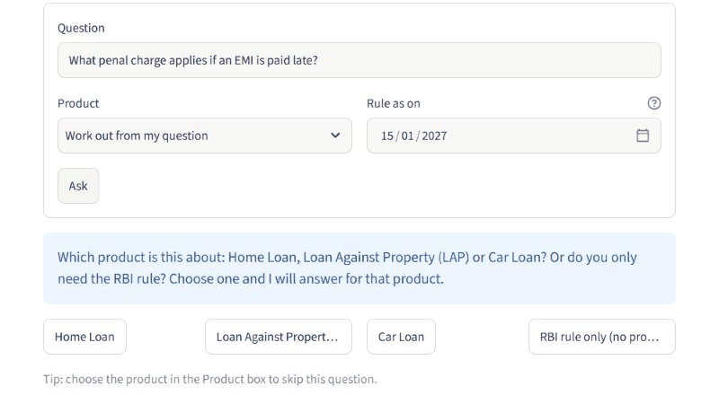
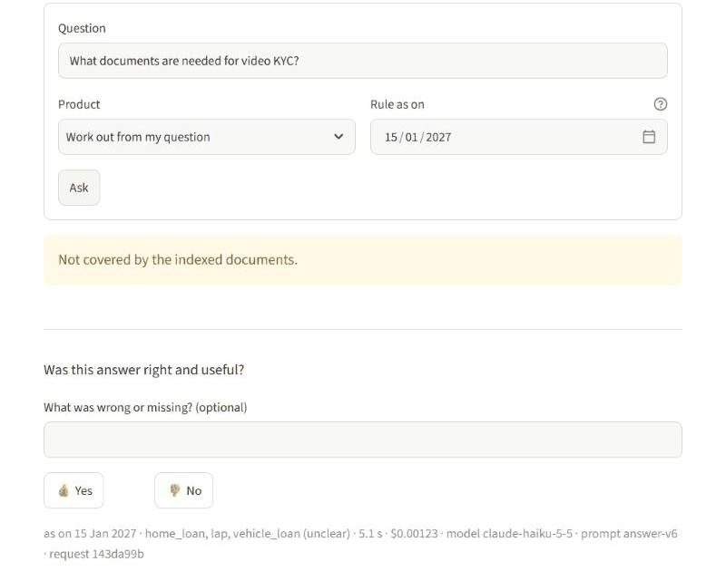
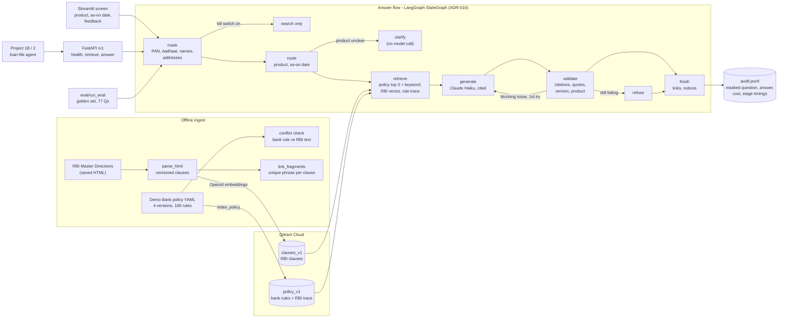

# bank-policy-qa

**Cited answers to lending-policy questions for Indian bank staff: the bank's own rule first, the RBI clause it
implements next, and a refusal when the documents don't support an answer.**

> "Can an HUF apply for a home loan?"
> **No.** Under Demo Bank rule DB-HL-003 (Home Loan, eligible applicants), an HUF is not eligible. The rule is a
> bank-discretion rule with no RBI requirement. It limits applicants to resident Indian individuals who are
> salaried, self-employed professionals or self-employed non-professionals, and because that list is complete, an
> HUF falls outside it.
>
> *(first paragraph of the system's answer, golden question v09, as on 15 Dec 2026, eval run of 28 Nov 2026)*

It answers for three retail products of **Demo Bank**, a fictional bank whose policy is written from the published
terms of large Indian banks, and for two RBI Master Directions. It is built as the retrieval layer of a loan
origination system: the same `/v1` API will serve an agentic loan-file checker (Project 1B) and the full system
(Project 2).

## Why this exists

Seven discovery interviews with branch and retail-credit staff (Nov 2026) changed the design:

| Finding | What it changed |
|---|---|
| The main source of answers is the **bank's own policy** (4/7 mostly policy, 3/7 mixed, 0/7 mostly public RBI text) | A bank-policy layer that traces every rule to the RBI clause it implements ([ADR-004](docs/adr/004-pivot-option-c.md), [ADR-005](docs/adr/005-policy-collection.md)) |
| The pain is **"what changed, and did everyone hear?"**, not looking up an old date | A "what changed" circular between policy versions, and answers from the version in force on a date ([ADR-008](docs/adr/008-policy-change-circular.md), [ADR-010](docs/adr/010-policy-version-by-date.md)) |
| 3/7 had a costly incident (wrong stamp duty, LTV change not followed, audit point after a change) | Citations on every statement and a checker that refuses unsupported answers ([ADR-014](docs/adr/014-answer-validator.md)) |
| **7/7 may not use ChatGPT or other outside tools**: data leaving the bank is the concern | PAN, Aadhaar, account numbers, names and addresses are masked before anything leaves the machine ([ADR-015](docs/adr/015-pii-masking.md), [ADR-021](docs/adr/021-name-and-address-masking.md)) |

## What it does

- **Bank rule first, then RBI.** 106 Demo Bank rules (home loan v1.0 and v1.1, loan against property v1.0, new-car
  loan v1.0), each tagged with the RBI paragraph it implements or marked as bank discretion; 1,039 parsed
  paragraphs and sub-clauses of the RBI Credit Facilities and Responsible Business Conduct Directions, 2025 (as on 1 Oct 2026).
- **Right product, right version.** A product filter keeps a LAP question away from the home-loan LTV
  ([ADR-009](docs/adr/009-product-filter.md), [ADR-012](docs/adr/012-rbi-clause-product-scope.md)); an "as on" date
  picks the policy version in force ([ADR-010](docs/adr/010-policy-version-by-date.md)).
- **Asks instead of guessing.** If neither the caller nor the question names a product and more than one is in force,
  it asks which one: no search, no model call, no cost ([ADR-018](docs/adr/018-clarify-product.md)).
- **Every answer checked.** Cited sources must have been retrieved, quotes must appear in the source, the rule
  version must be in force and belong to the product. One retry, then the exact refusal
  "Not covered by the indexed documents." ([ADR-014](docs/adr/014-answer-validator.md),
  [ADR-017](docs/adr/017-named-retrieved-not-cited.md)).
- **Links that land on the clause.** Each RBI citation opens rbi.org.in and highlights that paragraph; 972 of 975
  links verified live ([ADR-019](docs/adr/019-citation-link-phrases.md)).
- **Personal data masked first.** The question is masked before the embedding call, the search, the model and the
  audit log ([ADR-015](docs/adr/015-pii-masking.md), [ADR-021](docs/adr/021-name-and-address-masking.md)).
- **Operable.** `/v1` API with OpenAPI docs, kill switch to search-only mode, audit log of every request with
  cost, latency per stage and retries ([ADR-013](docs/adr/013-retrieval-api-v1.md)).

## Screens

A question with a made-up customer name and address: both are masked before anything leaves the machine, and the
answer gives the bank rule, the RBI paragraph it implements, and a link that highlights that paragraph on rbi.org.in.



No product named, three products in force: it asks instead of answering three times (no search, no model call).



Outside the indexed documents: the exact refusal, no guess.



## Results (golden_v2_4, 77 questions, 28 Nov 2026)

| Metric | Product given by the screen | Product read from the question |
|---|---|---|
| Expected RBI paragraph in the top 5 | 29/29 | 29/29 |
| Expected RBI paragraph cited | 28/29 | 29/29 |
| Expected Demo Bank rule found / cited | 52/52 / 52/52 | 52/52 / 52/52 |
| Only rules of the right product cited | 52/52 | 52/52 |
| Refused exactly when it should | 77/77 | 77/77 |
| Asked "which product?" exactly when it should | 25/25 | 38/38 |
| Cost for 77 questions / median latency | $0.084 / 5.7 s | $0.086 / 5.6 s |

Name and address masking (ADR-021), on questions not used to build the rules: names 20/21 (95.2%), address parts
25/27; on 7 questions written by a banker, names 7/7. Run notes and every miss: [eval/reports/failures.md](eval/reports/failures.md).

## Architecture



The screen, the API and the eval all call the same answer flow, so the eval measures what staff and 1B get.
LangChain is used only where it saves code (embeddings, Qdrant store, structured output for the circular); the
prompt, citations and checks are plain Python so every step can be tested offline
([ADR-001](docs/adr/001-langchain-boundary.md)).

## Run it (Windows, PowerShell)

Needs Python 3.12, an Anthropic API key, an OpenAI API key (embeddings) and a Qdrant Cloud cluster.

```powershell
python -m venv .venv ; .\.venv\Scripts\Activate.ps1
pip install -r requirements.txt            # includes the ~425 MB spaCy model used for name masking
copy .env.example .env                     # add ANTHROPIC_API_KEY, OPENAI_API_KEY, QDRANT_URL, QDRANT_API_KEY
```

First time only — build the indexes. RBI text is not redistributed: save the two Master Direction pages from
rbi.org.in (URLs in `data/sources.yaml`) to `data/raw/` first.

```powershell
python -m ingest.parse_html credit_facilities
python -m ingest.parse_html responsible_business_conduct
python -m ingest.index credit_facilities responsible_business_conduct
python -m ingest.index_policy
python -m ingest.link_fragments
```

Use it:

```powershell
streamlit run ui/streamlit_app.py           # the staff screen
uvicorn app.api:app --port 8000             # the /v1 API; OpenAPI docs at http://127.0.0.1:8000/docs
python -m pytest -q                         # offline tests, no API keys needed
python -m eval.run_eval                     # golden set, product given (about 8 min, about $0.09)
$env:PRODUCT_CONTEXT = "text"; python -m eval.run_eval; Remove-Item Env:PRODUCT_CONTEXT
```

## Design decisions

| ADR | Decision | Status |
|---|---|---|
| [001](docs/adr/001-langchain-boundary.md) | LangChain only for embeddings, vector store and structured output; prompt, citations and checks in plain Python | accepted |
| [002](docs/adr/002-clause-schema.md) | Every clause carries document, version and date fields from day one | accepted |
| [003](docs/adr/003-citation-links.md) | Citations link to the clause on rbi.org.in (text-fragment link, section-anchor fallback) | accepted; permission needed before a public launch |
| [004](docs/adr/004-pivot-option-c.md) | After discovery: add a bank-policy layer now, test a head-office user in parallel | accepted |
| [005](docs/adr/005-policy-collection.md) | Bank policy in its own collection, searched with RBI, each rule traced to its RBI clause | accepted |
| [006](docs/adr/006-conflict-check.md) | Bank-vs-RBI conflict check: traced RBI text + model verdict, proven on planted fixtures, human sign-off for unstable verdicts | accepted |
| [007](docs/adr/007-hybrid-search.md) | Hybrid keyword + vector search for RBI clauses | superseded: no measured gain, back to vector |
| [008](docs/adr/008-policy-change-circular.md) | "What changed" circular between policy versions: code diff, model wording, automatic checks, reviewer corrections | accepted |
| [009](docs/adr/009-product-filter.md) | Filter bank rules by product | accepted |
| [010](docs/adr/010-policy-version-by-date.md) | Answer from the policy version in force on the "as on" date | accepted |
| [011](docs/adr/011-policy-keyword-slot.md) | One keyword (BM25) slot in the policy search, after vector top 3 | accepted |
| [012](docs/adr/012-rbi-clause-product-scope.md) | RBI clauses that apply to one product are not used for another | accepted |
| [013](docs/adr/013-retrieval-api-v1.md) | Versioned `/v1` API (health, retrieve, answer) and kill switch | accepted |
| [014](docs/adr/014-answer-validator.md) | Check every answer against what was retrieved; retry once, then refuse | accepted |
| [015](docs/adr/015-pii-masking.md) | Mask PAN, Aadhaar, phone, account and card numbers before search, model and log | accepted |
| [016](docs/adr/016-langgraph-answer-flow.md) | Run the answer flow as a LangGraph graph; old flow kept for rollback | accepted |
| [017](docs/adr/017-named-retrieved-not-cited.md) | A retrieved source named but not cited: warning plus code-added link, not a refusal | accepted |
| [018](docs/adr/018-clarify-product.md) | Ask which product when neither the caller nor the question says | accepted |
| [019](docs/adr/019-citation-link-phrases.md) | Citation links use a phrase unique on RBI's page and inside one block | accepted |
| [020](docs/adr/020-retry-when-bank-rule-named-not-cited.md) | Retry when a bank-rule answer names a rule but cites none | deferred: measured, 0 cases so far |
| [021](docs/adr/021-name-and-address-masking.md) | Mask person names and addresses (spaCy + rules), fail closed | accepted |

## What went wrong, and what it taught

- **An eval bug invented a problem.** "RBI search finds the right clause 7/14" was a scoring bug; a second script
  scoring the same thing exposed it. Evaluate the evaluator.
- **One shared index gave a wrong answer.** A LAP question got the home-loan LTV (75% instead of 65%). Fixed by the
  product filter and product-scoped RBI clauses.
- **A strict check made answers worse.** "Cite every source you name" made retries name sources that were never
  retrieved, and two correct answers were refused. Block only what is actually wrong.
- **The metric can't see the user's screen.** About 75 of 975 citation links highlighted the wrong paragraph,
  invisible to every eval score; found by checking against RBI's page and clicking.
- **The builder's test set shares the builder's blind spots.** Name masking scored 100% on the set its rules were
  built on and 95% on held-out questions; a banker's own 7 questions found a case neither set had (a locality with
  no house number).

## Limits

- Demo Bank is fictional; its rules come from the published terms of large Indian banks, never from any bank's
  internal circulars. Not legal or credit advice.
- Two RBI Master Directions only (Credit Facilities, Responsible Business Conduct); no KYC, priority-sector or NBFC
  directions yet.
- Masking can miss an unusual name, a name in Hindi or Marathi script, or a workplace locality.
- The golden set (77 questions) was written by the builder with interview questions mixed in; results on real
  branch traffic are unknown.
- Runs on cloud APIs (OpenAI embeddings, Anthropic, Qdrant Cloud): a bank deployment would need hosting inside the
  bank's network.

## Project status

Progress log: [PROGRESS.md](PROGRESS.md). Next: eval report page, CI, and the design of Project 1B, an agent that
checks a loan file against these rules through `/v1`.
